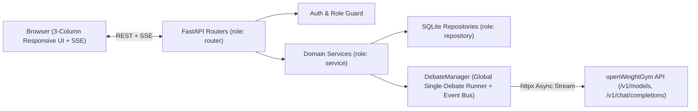

# AI-Debate — Implementation Plan

A self-hosted Python web application that orchestrates real-time, streaming back-and-forth debates between two AI models served via an OpenAI-compatible openWeightGym API ([app-builder.md](./app-builder.md)).

---

## 1. Development Methodology (Tool-First Development)

This project is built using the **Tool-First Development** workflow configured in [AGENTS.md](./AGENTS.md) and `.agents/`:

1. **Before creating or editing any module**: call MCP tools `get_conventions`, `find_similar`, and `lookup_symbol` (from the `project-dev` MCP server) instead of broad file reads or shell greps.
2. **Tests first**: write or update covering tests under `tests/` before writing production code (`contract-first-test` pattern).
3. **Structured module headers**: every module under `app/` (Python) and `app/static/js/` (JS) must start with a valid header (`Purpose`, `Role`, `Patterns`, `Depends on`, `Exposes`, `Tests`, `Invariants`) using only roles and patterns registered in [.agents/config.json](./.agents/config.json) and [.agents/RULES.md](./.agents/RULES.md).
4. **Verify via MCP tools**: use `run_tests` and `lint_and_headers` (raw shell `pytest`/`ruff` and edits to `.agents/state/` or `.env` are blocked by `PreToolUse` hooks).
5. **Continuous knowledge graph**: AST/headers sync on every edit (`PostToolUse`), and OpenWeightGym summaries + dense embeddings sync incrementally after every turn (`Stop` hook) and on git commit (`post-commit`).
6. **Sandboxed execution**: built and tested inside [DevDockerfile](./DevDockerfile) (`APP_VENV=/opt/app-venv`, `DEV_TOOLS_PYTHON=/opt/dev-tools-venv/bin/python`).

---

## 2. Architecture & Tech Stack

- **Backend**: Python 3.12+, **FastAPI**, **Uvicorn**, **httpx** (async streaming SSE client), **SQLite** (WAL mode), **Jinja2** templates.
- **Frontend**: Semantic HTML + modular CSS (`theme-tokens` CSS custom properties) + Vanilla ES modules (`EventSource` / `fetch` streaming, safe Markdown rendering). Zero Node/npm build step.
- **Security**:
  - Passwords hashed with `hashlib.scrypt` (per-user random salt).
  - Signed `HttpOnly`, `SameSite=Lax` session cookies.
  - Shared API key encrypted at rest in SQLite using Fernet (`cryptography`) with an auto-generated `0600` local keyfile (or `APP_SECRET_KEY` env var). Never returned in plain text to clients or written to logs.



---

## 3. Project Layout (Mapped to `.agents/RULES.md` Roles)

```text
AI-Debate/
├── app/
│   ├── main.py                       # FastAPI entrypoint, lifespan, static/template mounting (role: router)
│   ├── config.py                     # Env settings, data dir, secret key management (role: util)
│   ├── errors.py                     # Typed domain errors (`structured-errors`) (role: schema)
│   ├── schemas.py                    # Pydantic request/response DTOs (role: schema)
│   ├── security.py                   # scrypt password hashing, sessions, Fernet encryption (role: util)
│   ├── repositories/
│   │   ├── db.py                     # SQLite WAL connection factory & schema migrations (role: repository)
│   │   ├── users_repo.py             # Users & sessions CRUD (role: repository)
│   │   ├── settings_repo.py          # Singleton app_settings & encrypted API key CRUD (role: repository)
│   │   ├── prompts_repo.py           # Per-user custom prompts CRUD (role: repository)
│   │   └── debates_repo.py           # Debates, messages, and compactions CRUD (role: repository)
│   ├── services/
│   │   ├── llm_client.py             # openWeightGym HTTP client, SSE parser, headers & error matrix (role: service)
│   │   ├── thinking_parser.py        # Streaming parser for reasoning_content & <think>...</think> (role: util)
│   │   ├── prompt_builder.py         # Composes Style + Conviction + Side + Scene + role-flipped history (role: util)
│   │   ├── compaction.py             # Context window tracker, rolling summary compaction, context_too_small recovery (role: service)
│   │   └── debate_manager.py         # Global single-debate async runner + live SSE pub/sub (role: service)
│   ├── routers/
│   │   ├── auth.py                   # Register, login, logout, current user, theme preference (role: router)
│   │   ├── admin.py                  # Server URL/port/API key, optional headers, Test Connection, user management, busy force-stop (role: router)
│   │   ├── models.py                 # Proxied /v1/models filtered to chat models + context/thinking caps + node status (role: router)
│   │   ├── prompts.py                # Built-in presets + per-user custom prompt CRUD (role: router)
│   │   └── debates.py                # Debate CRUD, start/pause/resume/stop/continue, interject, compact, fork, export, SSE stream (role: router)
│   ├── templates/
│   │   ├── base.html
│   │   ├── login.html
│   │   ├── app.html                  # 3-column responsive debate workspace + drawers
│   │   └── admin.html                # Admin settings & user management
│   └── static/
│       ├── css/
│       │   ├── base.css              # Layout, responsive breakpoints, chat bubbles, thinking drawers
│       │   └── themes.css            # 5 switchable themes via CSS custom properties (`theme-tokens`)
│       └── js/
│           ├── api.js                # Fetch wrapper + structured error banner helper (role: component)
│           ├── markdown.js           # Safe lightweight Markdown + code block renderer (role: component)
│           ├── sse.js                # Live debate stream client with auto-reconnect (role: component)
│           └── app.js                # Workspace state, model panels, debate controls, export/fork (role: page)
├── tests/
│   ├── test_thinking_parser.py
│   ├── test_prompt_builder.py
│   ├── test_compaction.py
│   ├── test_auth_and_roles.py
│   ├── test_llm_client.py            # Context headers, thinking params, error codes, Strata/adaptor guards
│   └── test_debate_flow.py           # End-to-end mock openWeightGym SSE streaming + global lock tests
├── requirements.txt
└── run.py                            # Single-command launcher (python run.py)
```

---

## 4. Database Schema (SQLite WAL)

| Table | Purpose |
|---|---|
| `users` | `id`, `username` (unique), `password_hash`, `role` (`admin`/`user`), `theme`, `show_thinking_default`, `is_active`, `created_at` |
| `sessions` | `token_hash`, `user_id`, `expires_at`, `created_at` |
| `app_settings` | Singleton row: `api_protocol` (`http`/`https`), `api_host`, `api_port`, `api_key_encrypted`, `open_registration`, `suite_application`, `default_priority`, `default_sensitivity`, `default_node`, `log_off`, `no_wake` |
| `custom_prompts` | `id`, `user_id`, `name`, `style_category`, `content`, `created_at`, `updated_at` |
| `debates` | `id`, `user_id`, `title`, `scene_prompt`, `first_speaker` (`A`/`B`/`random`), `resolved_first_speaker`, `status` (`draft`/`running`/`paused`/`limit_reached`/`stopped`/`error`), `turn_limit`, `time_limit_seconds`, `elapsed_active_seconds`, `auto_compact_threshold` (default `0.78`), `keep_recent_turns` (default `4`), `show_thinking`, `model_a_config` (JSON), `model_b_config` (JSON), `model_a_ctx_loaded`, `model_a_ctx_guaranteed`, `model_a_ctx_max`, `model_b_ctx_loaded`, `model_b_ctx_guaranteed`, `model_b_ctx_max`, `last_error`, `created_at`, `updated_at` |
| `messages` | `id`, `debate_id`, `turn_index`, `sender` (`A`/`B`/`moderator`), `model_id`, `answered_model_id`, `answered_node`, `content`, `thinking`, `prompt_tokens`, `completion_tokens`, `loaded_context_tokens`, `duration_ms`, `tokens_per_sec`, `request_id`, `loadcoach_request_id`, `finish_reason`, `created_at` |
| `compactions` | `id`, `debate_id`, `through_message_id`, `summary_text`, `summarizer_model_id`, `trigger_reason` (`auto`/`manual`/`context_too_small`), `created_at` |

> **Note:** Original `messages` are never deleted on compaction. The UI displays the full history with a centered collapsible **"Context Compacted"** divider, while subsequent LLM requests send `[System + Scene] + [Latest Summary] + [Messages after through_message_id]`.

---

## 5. Key Subsystems & Exact openWeightGym Contracts ([app-builder.md](./app-builder.md))

### 5.1 Global Single-Debate Execution Lock
- Only **1 debate may be actively running across the entire application** at any time (enforced atomically inside `DebateManager` via an `asyncio.Lock` and a single active slot).
- If any user attempts to start or resume a debate while another is running:
  - Return `409 Conflict` without leaking another user's private debate title or content (*"A debate is currently running on the server. Please wait until it pauses or finishes."*).
  - If the active debate belongs to the *same* user, highlight it with a direct jump link.
  - Admins can see busy status and force-stop a stuck active debate from the Admin panel without viewing private transcripts.
- On app startup, any debate left in `running` state from an unexpected shutdown transitions cleanly to `paused`.

### 5.2 openWeightGym Model Discovery, Context Windows & Headers
- **Dynamic model discovery**: Always call `GET /v1/models`; filter to `capabilities.chat == true`. Never hard-code model IDs.
- **Per-model metadata extracted from `/v1/models`**:
  - `context`: `{"guaranteed": int, "max": int}` — shown in model dropdowns and used for pre-turn-1 context estimates.
  - `locations[*].loaded_context`: live snapshot of currently loaded window on each node (absent if unloaded).
  - `locations[*].chat_template_caps`: `supports_reasoning_effort` and `reasoning_effort_levels` (lowest → highest) when loaded.
  - `capabilities.streaming`: if `false`, seamlessly fall back to non-streaming completion and emit a synthetic stream completion event.
  - `owned_by == "adaptor"`: agent chat model subtype (accepts only `model`, `messages`, `stream`, `reasoning_effort`, `n`; omit sampling params to avoid dropped-field noise and surface `X-Suite-Ignored-Parameters` if present).
  - `unavailable_machines`: badge models whose enabled locations are all unavailable (`"Node may wake"`); show `"Waking compute node…"` if first token takes >3s.
- **Request headers**:
  - Always send `Authorization: Bearer <key>` and `X-Suite-Application` (default `ai-debate`).
  - Send `X-LoadCoach-Trace: debate-{id}` and optional `X-LoadCoach-Sensitivity` **only when `X-LoadCoach-Log: off` is NOT enabled** (enforcing the `app-builder.md` mutual exclusion rule).
  - Optional Admin headers: `X-LoadCoach-Priority` (`high`/`normal`/`low`), `X-Suite-Node` (optional destination node), `X-Turnstile-No-Wake: 1`.
- **Response headers captured per turn**:
  - `X-LoadCoach-Context-Tokens`: exact context window served for that turn (immediately updates the debate's live context meter & compaction threshold for that model!).
  - `X-Request-ID` & `X-LoadCoach-Request-ID`: stored per message and logged on errors.
  - `X-LoadCoach-Answered` & `X-LoadCoach-Node`: displayed when a role name resolves to a concrete model.
  - `X-LoadCoach-Estimated-Wait`: shown as a live status hint while queued (`"Queued (~Xs wait)…"`).
  - `X-Turnstile` (`compute-off` / `busy` on `503`) + `Retry-After`: shown clearly in status/error banners.
  - `X-Suite-Allowance`: show non-blocking warning toast if spending allowance is nearing its limit.
- **Error matrix (branch on HTTP status + `error.code`, never message text)**:
  - `400` + `code == "context_too_small"`: read `error.loaded_context` and `error.max_context`, update that model's active context limit, auto-compact to fit `loaded_context`, and retry once.
  - Other `400` / `413`: surface `error.message` and pause debate; do not retry unchanged.
  - `401` / `403`: surface clear auth/permission banner; do not retry.
  - `404`: refresh `/v1/models` cache and notify user.
  - `409`: surface `error.message` and pause.
  - `429` / `503`: honor `Retry-After` and `X-Turnstile` (`compute-off` vs `busy`); pause with retry option.
  - `502` / `504`: single automatic retry after short backoff, then pause with error if still failing.
  - Mid-stream disconnect without `[DONE]` / `finish_reason`: mark partial turn and pause so user can retry cleanly.

### 5.3 Per-Model Thinking Control & Streaming Auto-Collapse
- **API request controls per model** (from `app-builder.md#app-thinking`):
  - **Thinking mode selector**: `Model default` (omit fields) | `Off` (`"chat_template_kwargs": {"enable_thinking": false}`, plus `"reasoning_effort": "none"` if `supports_reasoning_effort`) | `On` (`"chat_template_kwargs": {"enable_thinking": true}`).
  - **Reasoning effort selector**: dynamically shown when `chat_template_caps.supports_reasoning_effort` is true, populated from `reasoning_effort_levels`.
  - Default `max_tokens` set generously (e.g., `2048`) because thinking tokens count against `max_tokens`; warn in UI if `max_tokens < 512` while thinking is enabled, and show a clear hint if `finish_reason == "length"` with empty `content`.
- **Streaming parser (`ThinkingParser`)**:
  - Handles both structured `choices[0].delta.reasoning_content` (and `delta.reasoning`) AND inline `<think>...</think>` tags inside `delta.content` (buffering partial tag boundaries across chunks).
- **UI behavior**:
  - Global **Show / Hide Thinking** toggle in the debate header.
  - When **Shown**: Thinking streams live inside an expanded box on that model's side (left for A, right for B), then smoothly auto-collapses to a clickable `"Thought for Xs — Show"` header the moment answer tokens start streaming.
  - When **Hidden**: Thinking is still persisted in SQLite (available when toggling Show Thinking later or on export), while showing a subtle `"Thinking…"` indicator until answer tokens begin.

### 5.4 Prompt Composition & Turn Role-Mapping
Each model panel configures:
1. **Model** (from `/v1/models`, displaying `guaranteed–max` context range and node status) + optional editable display label.
2. **Style preset**: `Cooperative`, `Adversarial`, `Explorative`, or any user-saved **Custom Prompt** (Save / Update / Delete).
3. **Conviction level**: `Immovable (Never change position)`, `Firm (High evidence bar)`, `Balanced (Open to strong arguments)`, `Flexible (Willing to shift)`, `Synthesis-seeking`.
4. **Side / Position**: Free-text position the model holds on the topic.
5. **Composed System Prompt Preview**: Live preview (with optional manual override) combining Style + Conviction + Side + opponent label.
6. **Advanced Controls**: `temperature`, `top_p`, `max_tokens`, optional `seed`, plus **Thinking mode** / **Reasoning effort**.

Role-mapping when calling **Model A**:
- `system`: Model A's composed system prompt + Debate Scene (plus latest compaction summary when present).
- History messages (always excluding `thinking`):
  - Model A's prior turns → `role: "assistant"`
  - Model B's prior turns → `role: "user"`
  - Moderator interjections → `role: "user"` prefixed with `[Moderator]: `
- Symmetric mirror when calling **Model B**.
- Turn 1 sends a clean opening `user` prompt inviting the resolved first speaker (`A`, `B`, or `random` coin flip) to present its opening position.

### 5.5 Context Compaction (Manual + Automatic)
- **Live Context Meter** on both Model A and Model B panels showing `prompt_tokens / effective_context` (`%`, color-coded green → amber → red) and tooltip showing `loaded_context` vs `guaranteed–max` window.
- **Automatic Trigger**: Before each turn, estimate upcoming total tokens (`last_prompt_tokens + new_messages_estimate + max_tokens` — note the server uses ~3 bytes/token plus `max_tokens`). If it exceeds `auto_compact_threshold` (default `78%`) of the upcoming speaker's active window (`loaded_context`, falling back to `context.guaranteed` before Turn 1)—or on HTTP `400` `context_too_small`—compact automatically.
- **Manual Trigger**: **"Compact Now"** button compacts immediately (when paused) or at the next turn boundary (when running).
- **Summarization Process**:
  - Preserves Scene Prompt + last `keep_recent_turns` (default `4`) messages verbatim.
  - Summarizes older turns (+ any prior summary) into a concise neutral digest preserving both models' theses, key arguments, concessions, and open disputes.
  - Uses whichever active model has the larger active context window (preferring non-`adaptor` chat models), always passing `"chat_template_kwargs": {"enable_thinking": false}` (with 400 fallback) so compaction is fast and never burns `max_tokens` thinking.

### 5.6 Background Execution, Controls, Forking & Export
- `DebateManager` runs the active debate in a background `asyncio.Task` and buffers in-progress `thinking`/`content` chunks so refreshing or switching chats reconnects seamlessly to the live SSE stream.
- **Controls**: Start, Pause, Resume, Stop, **Continue** (`+5 turns`, `+10 turns`, `+5 min`, or custom) on `limit_reached`, **Moderator Interject** (immediately when paused, or queued for next turn), and mid-debate edits to temperature / `max_tokens` / stance / thinking mode.
- **Fork / Duplicate**: Creates a new draft debate copying all settings, with an optional **"Swap Sides"** toggle.
- **Export**: Download transcript as `.md` or `.json` with checkboxes to include/exclude thinking blocks and per-turn stats.

---

## 6. Responsive UI & Themes

- **Desktop (`≥ 1100px`)**:
  - Collapsible left **Debates History** drawer (new debate, search/list, rename, fork, delete).
  - 3-column workspace: **Model A Panel (Left)** | **Open WebUI-style Chat Feed + Moderator Bar (Center)** | **Model B Panel (Right)**.
  - Center chat: Model A cards offset left (Accent A), Model B cards offset right (Accent B), Moderator & Compaction cards centered, per-turn stats badge (`tokens`, `tok/s`, `time`, `ctx %`, answered model/node when using roles).
- **Tablet & Mobile (`< 1100px`)**:
  - Full-width center chat with top bar buttons to slide open Model A config, Model B config, or History drawer.
- **Built-in Themes** (CSS custom properties in `themes.css`, saved per user + `localStorage` instant apply):
  1. **Obsidian** (default sleek dark slate)
  2. **Daylight** (crisp light mode)
  3. **Midnight Neon** (deep navy + cyan/magenta accents)
  4. **Warm Paper** (editorial sepia/parchment)
  5. **Forest Terminal** (deep charcoal-green + emerald/amber accents)

---

## 7. Verification Plan (Tool-First Definition of Done)

1. **Automated Test Suite (via MCP `run_tests`)**:
   - `test_thinking_parser.py`: `reasoning_content`, `<think>...</think>`, split tags across SSE chunks, mixed/empty thinking.
   - `test_prompt_builder.py`: Role flipping for A vs B, thinking exclusion verification, conviction/style/side composition, moderator messages.
   - `test_llm_client.py`: `X-LoadCoach-Context-Tokens`, `context.guaranteed`/`max`, `chat_template_caps`, `chat_template_kwargs` / `reasoning_effort`, `X-LoadCoach-Log: off` mutual exclusion, `400 context_too_small` parsing, `owned_by == "adaptor"` field filtering.
   - `test_compaction.py`: Threshold detection with asymmetric model context limits, `X-LoadCoach-Context-Tokens` updates, manual compaction, reactive `400 context_too_small` recovery, thinking disabled on summarization calls.
   - `test_auth_and_roles.py`: First-user admin bootstrap, per-user isolation, admin-only settings/force-stop enforcement, encrypted API key storage.
   - `test_debate_flow.py`: End-to-end async streaming debate against a mocked openWeightGym SSE server covering global single-debate lock (`409` on concurrent start), turn/time limits, continuation, pause/resume, moderator interjection, mid-debate reconnection, fork/swap, and export.
2. **Style, Headers & Knowledge Graph (via MCP `lint_and_headers` & `index_status`)**:
   - Zero Ruff lint errors and zero missing/invalid module headers across `app/` and `tests/`.
   - `index_status` reports `fresh: true` with OpenWeightGym summaries and embeddings populated.
3. **Live Smoke Test**:
   - Run `python run.py`, create Admin account, configure OpenWeightGym host/port/key, verify **Test Connection**, run a live streaming debate between two models, verify thinking auto-collapse, themes, mobile responsiveness, and context compaction.
